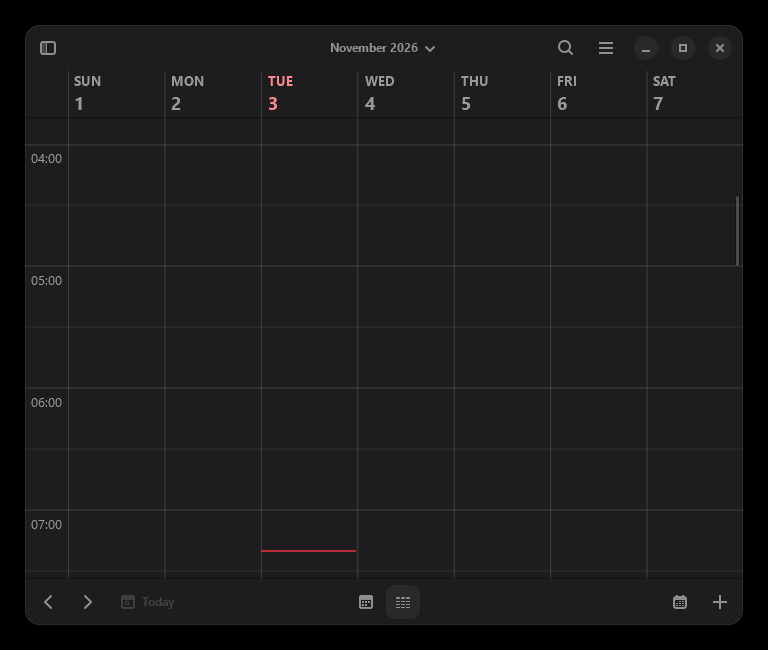

# GNOME Calendar on Windows: native build



This branch (`windows-native-port`) turns GNOME Calendar 50.0 into a native
64-bit Windows application. It is not a shortcut that starts WSL, and it does
not run a Linux desktop inside a virtual machine. `GNOME Calendar.exe` is a
normal Win32 process using GTK4's Windows backend, libadwaita, Evolution Data
Server, and a private D-Bus session.

The build is experimental but usable. It was developed and tested on Windows 11
(26200) with MSYS2 UCRT64.

## Why native instead of WSL?

WSL is excellent for Linux tooling, but it is the wrong runtime for a small
desktop calendar:

- **Startup cost.** Launching the app through WSL starts or wakes a Linux
  distribution, brings up the WSLg display stack, and then starts the app. A
  native process starts directly. On a cold start the difference is seconds,
  not milliseconds.
- **Memory and CPU overhead.** WSL 2 keeps a Linux kernel and a VM alive. A
  native GTK process does not. For an app that is supposed to be lightweight,
  paying for a second operating system is hard to justify.
- **Display translation.** WSLg translates Wayland/X11 into Windows. Native
  GTK4 uses the Win32 backend directly, so there is no extra compositor or
  protocol hop.
- **Windows integration.** Native windows participate normally in the taskbar,
  Alt-Tab, snapping, DPI changes, clipboard, drag and drop, input methods,
  file dialogs, and accessibility tools. WSLg windows are deliberately
  Linux-shaped and do not integrate as deeply.
- **Files and latency.** A native process reads and writes Windows files
  directly. It does not cross the `/mnt/c` boundary or a 9P filesystem.
- **No Linux userland to maintain.** There is no distribution to update, no
  WSL feature to enable, and no extra virtual disk. The bundle is a folder of
  Windows binaries and data files.
- **Offline by default.** The calendar is local-first. The native bundle does
  not need a WSL distribution, a Linux package manager, or a network connection
  to start.

The trade-off is that the Windows port has to carry its own runtime: GTK,
libadwaita, Evolution Data Server, D-Bus, GSettings schemas, icons, and the
GWeather location database. That is what `windows/build-bundle.sh` assembles.

## What works

- Month, week, and agenda views.
- The event editor and the calendar-management UI.
- Local calendars stored through Evolution Data Server.
- CalDAV/WebDAV calendars added manually through the calendar-management UI.
- GSettings-backed preferences, dark/light Adwaita themes, DPI scaling, and
  normal Windows keyboard/mouse input.
- The app starts from a self-contained bundle; the MSYS2 installation is only
  needed to build it.
- No console window: the app is linked as a Windows GUI subsystem executable,
  and the launcher hides the service consoles.

## Known limitations

- **Weather location.** GeoClue has no Windows provider. The build uses a small
  API-compatible stub, so the weather service has no automatic location and
  weather data is not shown. The rest of the calendar is unaffected.
- **GNOME Online Accounts.** The bundle does not include GNOME Online Accounts
  or the WebKit-based OAuth prompters. Google/Outlook account setup through
  GNOME Settings is therefore not part of this port. Manual CalDAV/WebDAV
  calendars are the supported path.
- **Desktop portal.** `xdg-desktop-portal` is a Linux desktop service. The app
  falls back to defaults for the system clock format and first weekday. The
  warnings in the log are harmless.
- **logind.** The clock component tries to acquire a logind D-Bus proxy for
  suspend/resume integration. Windows has no logind, so it logs a warning and
  continues.
- **GNOME Shell integration.** Search-provider and shell-calendar integration
  are Linux desktop features and are not available.
- **Architecture.** The build is x86_64 only.
- **Upstream status.** This is a fork branch, not an upstream GNOME release.

## What changed

### GNOME Calendar

The branch contains small, targeted Windows fixes:

- `src/core/gcal-log.c`: do not install the Unix `stdout` GIOChannel log handler
  on Windows. GUI processes do not have a reliable Unix-style stdout, and the
  handler could recurse while reporting its own failure.
- `src/utils/gcal-utils.c`: replace the glibc-specific `nl_langinfo()` day and
  month lookups with `strftime()`, remove the `ABDAY_*`/`MON_*` tables, and drop
  the POSIX `locale_t` usage. The `langinfo.h` include is guarded for Windows.
- `src/gui/common/gcal-date-chooser.c`: remove the `newlocale()`/`uselocale()`
  block, which has no Windows equivalent.
- `src/gui/event-editor/gcal-attendee-summary-row.c`: use `guint` instead of
  the BSD `uint` type.
- `src/gui/event-editor/gcal-schedule-section.c`: explicitly register
  `GcalDateChooserRow` and `GcalDateSelector` with `g_type_ensure()`. On Windows
  the static-library link can drop objects whose types are referenced only from
  GtkBuilder templates.
- `src/core/gcal-event.c`, `src/utils/gcal-utils.c`: when the local timezone is
  a Windows name that libical does not recognize (for example
  `India Standard Time`), convert new timed events to UTC before storing them.
  Without this, the local wall time was treated as UTC and events appeared
  shifted by the local offset.
- `src/gui/common/*.c`, `src/gui/event-editor/*.c`: guard the remaining
  `langinfo.h` includes.

### Evolution Data Server

Evolution Data Server is the calendar backend. Its Windows support had bit-rotted,
so the fork branch
[`vasil1729/evolution-data-server:windows-native-port`](https://github.com/vasil1729/evolution-data-server/tree/windows-native-port)
adds the required fixes:

- `struct stat`/`GStatBuf` corrections for `g_stat()` on MinGW.
- Winsock include ordering and `ws2_32` linkage.
- POSIX regex via MSYS2's `libsystre`.
- `localtime_r()` fallbacks for Windows.
- CMake fixes for native paths and the iconv/OAuth helper checks.
- A minimal UUID shim backed by Windows `rpcrt4.dll`.
- Smaller portability fixes in Camel, libedataserver, libecal, and the calendar
  backends.

The complete patch is included at
`windows/patches/evolution-data-server-windows.patch`. The build script applies
it automatically when building an upstream checkout; the fork branch already
contains it.

### Runtime bundle

`windows/build-bundle.sh` assembles:

- `gnome-calendar.exe`, `dbus-daemon.exe`, the Evolution Data Server factories,
  and the GeoClue stub.
- GTK4, libadwaita, GLib/GIO, Pango, Cairo, GdkPixbuf, GWeather, libsoup,
  libical, NSS, ICU, and the other runtime DLLs.
- GIO modules, GdkPixbuf loaders, GSettings schemas, Adwaita/hicolor icons,
  GTK data, fontconfig configuration, translations, and the GWeather
  `Locations.bin` database.
- The Evolution Data Server registry modules and calendar/addressbook backends.
- D-Bus service files rewritten for the bundle path.

The native launcher (`windows/launcher/native-launcher.cs`) sets the runtime
paths, starts a private D-Bus session, starts the Evolution Data Server
services, regenerates the GdkPixbuf loader cache for the current bundle
location, and then starts the app. It also kills the services when the calendar
window closes.

## Build requirements

- Windows 10 or 11, x86_64.
- [MSYS2](https://www.msys2.org/) with the UCRT64 environment.
- Git and about 10 GB of free disk space.
- .NET Framework 4.x for the launcher compiler (`csc.exe`).
- An internet connection for the initial MSYS2 package download.

## Build from scratch

Open the **MSYS2 UCRT64** shell, not the plain MSYS or MINGW64 shell.

### 1. Install the build dependencies

```bash
cd /path/to/gnome-calendar
bash windows/setup-msys2.sh
```

This installs the UCRT64 toolchain, GTK4, libadwaita, GWeather, Evolution Data
Server dependencies, D-Bus, Meson, Ninja, CMake, Blueprint, and `gperf`. It also
fixes the `blueprint-compiler` shebang if the MSYS2 package contains a
build-machine path.

### 2. Build and install Evolution Data Server

```bash
bash windows/build-eds.sh
```

The script clones the EDS Windows branch into `$HOME/src/evolution-data-server-windows`,
installs the UUID shim, configures EDS with the Windows-compatible options, and
installs it into `/ucrt64`.

If you prefer to build an upstream EDS checkout, set `EDS_REPO` and `EDS_BRANCH`
to point at it. The script will apply
`windows/patches/evolution-data-server-windows.patch` when it applies cleanly.

### 3. Build and install GNOME Calendar

```bash
bash windows/build-gnome-calendar.sh
```

The script builds the GeoClue stub, writes its pkg-config file, configures the
app with Meson, and installs it into `/ucrt64`.

### 4. Assemble the portable bundle

```bash
bash windows/build-bundle.sh
```

By default the bundle is written to
`C:\Users\<you>\GNOME-Calendar-Native`. Override the destination with the
`BUNDLE` environment variable, for example:

```bash
BUNDLE=/d/Apps/GNOME-Calendar-Native bash windows/build-bundle.sh
```

Only a few locales are copied by default (`en`, `en_GB`, `bg`). Use `LOCALES` to
copy more:

```bash
LOCALES="en en_GB bg de fr es" bash windows/build-bundle.sh
```

The script collects the runtime DLLs, copies the GTK/EDS data, rewrites the
D-Bus service files, and builds `GNOME Calendar.exe` with the native launcher.

### 5. Run it

Double-click:

```text
C:\Users\<you>\GNOME-Calendar-Native\GNOME Calendar.exe
```

The launcher starts a private D-Bus bus and the Evolution Data Server services
in the background. Logs are written to:

```text
%LOCALAPPDATA%\GNOME Calendar\logs
```

### 6. Optional: create a desktop shortcut

```powershell
powershell.exe -NoProfile -ExecutionPolicy Bypass `
  -File windows\launcher\build-launcher.ps1 `
  -BundleDir "C:\Users\<you>\GNOME-Calendar-Native" `
  -CreateDesktopShortcut
```

## Sharing the bundle

The `GNOME-Calendar-Native` folder is portable. Zip the folder and send it to
another Windows machine. The recipient extracts it anywhere and runs
`GNOME Calendar.exe`; no installer or WSL is required. The launcher starts the
private D-Bus session and the EDS services, regenerates the GdkPixbuf cache for
the new location, and stores calendar data in the recipient's own profile.

The bundle contains `README.txt` with the run instructions, the SmartScreen
note, the data locations, the known limitations, and the source/license links.
Windows may warn that the executable is unsigned; choose "More info" and then
"Run anyway".

The D-Bus service files contain absolute paths from the build machine. The
launcher starts the source registry, calendar factory, and address-book factory
directly, so the core calendar works after relocation. If you need D-Bus
activation of the optional services after moving the folder, rebuild the bundle
at the new location with `windows/build-bundle.sh`.

## Bundle layout

```text
GNOME-Calendar-Native/
  GNOME Calendar.exe        native launcher
  bin/
    gnome-calendar.exe      the GTK application
    dbus-daemon.exe
    gdk-pixbuf-query-loaders.exe
    libgeoclue-2.0.dll      GeoClue compatibility stub
    *.dll
  libexec/
    evolution-source-registry.exe
    evolution-calendar-factory.exe
    evolution-calendar-factory-subprocess.exe
    evolution-addressbook-factory.exe
    evolution-addressbook-factory-subprocess.exe
  lib/
    evolution-data-server/  EDS modules and backends
    gio/modules/
    gdk-pixbuf-2.0/2.10.0/loaders/
    libgweather-4/Locations.bin
  share/
    glib-2.0/schemas/       compiled GSettings schemas
    icons/                  Adwaita and hicolor
    gtk-4.0/
    dbus-1/
    locale/
  etc/fonts/
```

The bundle is relocatable. The launcher regenerates the GdkPixbuf cache with the
current absolute path and sets `GIO_EXTRA_MODULES`, `GSETTINGS_SCHEMA_DIR`,
`LIBGWEATHER_LOCATIONS_PATH`, and the Evolution Data Server module paths. It was
tested with the MSYS2 installation temporarily hidden, so it does not depend on
`C:\msys64` at runtime.

## Troubleshooting

**`blueprint-compiler` fails with `bad interpreter`**

Run `windows/setup-msys2.sh` again; it rewrites the shebang to
`/ucrt64/bin/python3.exe`.

**`You need gperf to build evolution-data-server`**

Install the MSYS package:

```bash
pacman -S gperf
```

**`Dependency "libgeoclue-2.0" not found`**

Run `windows/build-gnome-calendar.sh`; it builds and installs the stub.

**`Dependency "uuid" not found`**

Run `windows/build-eds.sh`; it installs the UUID shim.

**The app starts but shows no calendars**

Check that the Evolution Data Server services are running and look at
`%LOCALAPPDATA%\GNOME Calendar\logs\sources.log` and `calendar.log`. The launcher
starts them automatically; running `gnome-calendar.exe` directly without the
launcher will not set up D-Bus or the EDS module paths.

**Portal and logind warnings**

These are expected on Windows. The app falls back to defaults for the clock
format and first weekday, and the suspend/resume integration is unavailable.

## Licensing

GNOME Calendar and Evolution Data Server are licensed under the GNU General
Public License, version 3 or later (`GPL-3.0-or-later`). The Windows port
changes are distributed under the same license. If you redistribute a bundle,
make the corresponding source available; this repository and the Evolution Data
Server fork contain the patched sources.

## Links

- This branch: <https://github.com/vasil1729/gnome-calendar/tree/windows-native-port>
- Evolution Data Server branch: <https://github.com/vasil1729/evolution-data-server/tree/windows-native-port>
- OpenWiki documentation: [`openwiki/quickstart.md`](openwiki/quickstart.md)
- Blog post: <https://vasil1729.github.io/blog/native-gnome-calendar-on-windows/>
- Upstream GNOME Calendar: <https://gitlab.gnome.org/GNOME/gnome-calendar>
- Upstream Evolution Data Server: <https://gitlab.gnome.org/GNOME/evolution-data-server>
